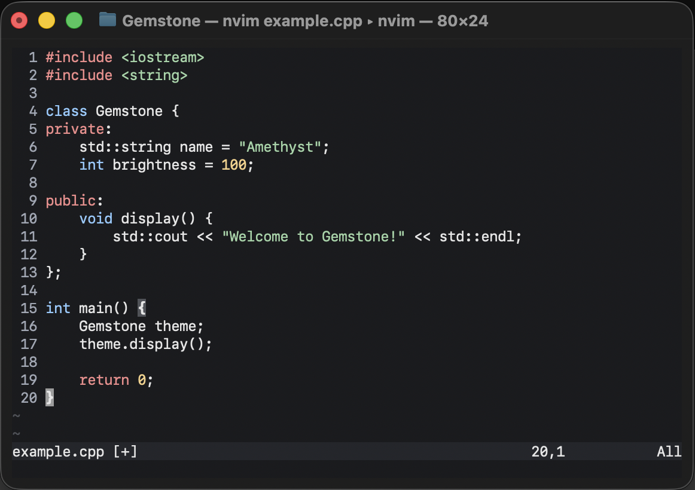

<div align="center">
  

  <h1>💎 Gemstone.nvim</h1>

  <p>
    A dark Neovim colorscheme inspired by pastel gemstones.
  </p>

  <p>
    Ruby • Amethyst • Emerald • Diamond • Sapphire
  </p>
</div>


---

## Preview




---

## Installation

### Using lazy.nvim

Add the following to your Neovim `init.lua` plugin configuration:

```lua
{
  "YOUR_USERNAME/Gemstone",
  lazy = false,
  priority = 1000,
  config = function()
    vim.cmd.colorscheme("gemstone")
  end,
},
```

### Manual Installation

Clone the repository into your Neovim configuration:

```bash
git clone https://github.com/YOUR_USERNAME/Gemstone.git \
  ~/.config/nvim/pack/themes/start/Gemstone
```

Then add the following to your `init.lua`:

```lua
vim.opt.termguicolors = true
vim.cmd.colorscheme("gemstone")
```

