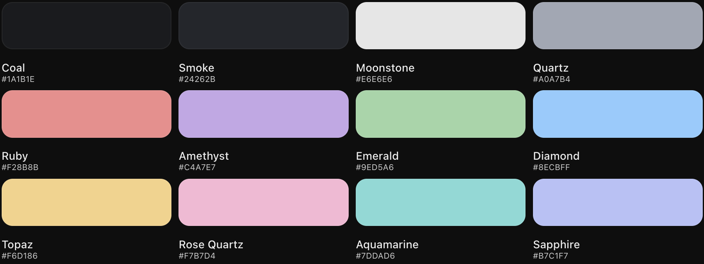

<div align="center">
  

  <h1>💎 Gemstone.nvim</h1>

  <p>
    A dark Neovim colorscheme inspired by pastel gemstones.
  </p>

  <p>
    Ruby • Amethyst • Emerald • Diamond • Sapphire
  </p>
</div>


---

## Preview


---

## Installation

### Using lazy.nvim

Add the following to your Neovim `init.lua` plugin configuration:

```lua
{
  "YOUR_USERNAME/Gemstone",
  lazy = false,
  priority = 1000,
  config = function()
    vim.cmd.colorscheme("gemstone")
  end,
},
```

### Manual Installation

Clone the repository into your Neovim configuration:

```bash
git clone https://github.com/YOUR_USERNAME/Gemstone.git \
  ~/.config/nvim/pack/themes/start/Gemstone
```

Then add the following to your `init.lua`:

```lua
vim.opt.termguicolors = true
vim.cmd.colorscheme("gemstone")
```


---

## Color Palette

Gemstone combines a dark, smoky charcoal background with
soft pastel colors inspired by precious gemstones.

| Gemstone | Hex Code | Usage |
|----------|----------|-------|
| Coal | `#1A1B1E` | Main background |
| Smoke | `#24262B` | Secondary background |
| Moonstone | `#E6E6E6` | Primary text |
| Quartz | `#A0A7B4` | Comments and muted text |
| Ruby | `#F28B8B` | Keywords and control flow |
| Amethyst | `#C4A7E7` | Functions and methods |
| Emerald | `#9ED5A6` | Strings and characters |
| Diamond | `#8ECBFF` | Types and classes |
| Topaz | `#F6D186` | Numbers and constants |
| Rose Quartz | `#F7B7D4` | Parameters and properties |
| Aquamarine | `#7DDAD6` | Operators |
| Sapphire | `#B7C1F7` | Special syntax |


### Palette Preview

<div align="center">
  
</div>


---

## Features

- Dark coal-grey background with smoky charcoal accents
- Soft pastel colors inspired by precious gemstones
- Syntax highlighting for C++, Ruby, Lua, and other languages
- Support for Neovim's built-in syntax highlighting
- Tree-sitter highlight group support
- Custom diagnostic colors for errors, warnings, and hints
- Lightweight and written entirely in Lua
- Compatible with lazy.nvim

## Requirements

- Neovim 0.8 or newer
- A terminal with true-color support recommended
- Tree-sitter optional for enhanced syntax highlighting

